<p align="center">
  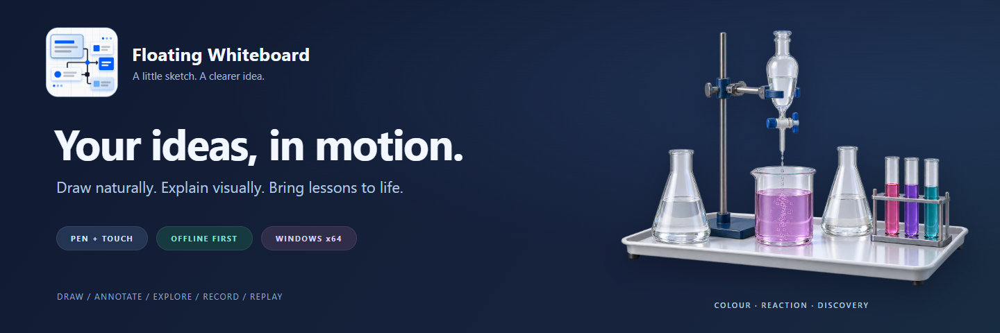
</p>

<h1 align="center">Floating Whiteboard</h1>

<p align="center">
  <strong>A pen-first Windows whiteboard for the way you think, teach and explain.</strong><br />
  Sketch on a canvas. Annotate your screen. Turn a scientific idea into something you can move.
</p>

<p align="center">
  <a href="LICENSE">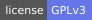</a>
  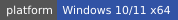
  
  
</p>

<p align="center">
  <a href="#get-started">Get started</a> ·
  <a href="#see-it-move">See it move</a> ·
  <a href="docs/USER-GUIDE.md">User guide</a> ·
  <a href="ROADMAP.md">Roadmap</a> ·
  <a href="CONTRIBUTING.md">Contribute</a>
</p>

<p align="center">
  <a href="https://www.electronjs.org/"></a>&nbsp;&nbsp;
  <a href="https://www.typescriptlang.org/"></a>&nbsp;&nbsp;
  <a href="https://preactjs.com/"></a><br />
  <sub>Electron + TypeScript + Preact · a custom Canvas2D drawing engine</sub>
</p>

## A board that stays out of your way

Use it for a quick explanation, a live lesson, a worked example or notes over another application.
The core drawing and science workflows run locally, without an account, API key or model download.

<p align="center">
  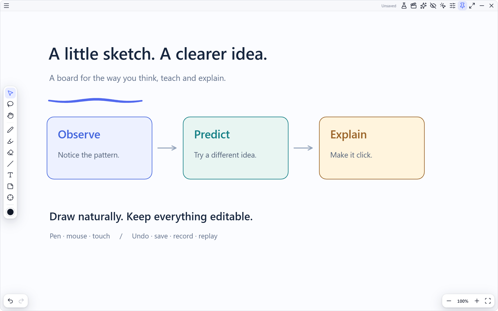
</p>

| Make your thinking visible | Keep the work yours |
| --- | --- |
| **Natural ink.** Pressure-sensitive pen strokes, mouse drawing, optional finger drawing and two-finger pan/zoom. | **Editable objects.** Text, notes, shapes, labels, groups, locks, transforms and object styling. |
| **A floating canvas.** Adjust opacity, write over your screen and switch to pointer pass-through when you need the app underneath. | **Local files.** Native saves, visible save status, recovery snapshots and PNG export. |
| **Tools within reach.** A press-and-hold radial menu, stroke/pixel erasers, a fading laser and keyboard shortcuts. | **Reusable explanations.** Record ink and edits, replay a lesson, keep an editable frame or export a silent WebM. |

## See it move

The animation library contains **14 native offline experiments**, with three deeper studios for physics,
chemistry and biology. Their controls, diagrams, graphs and saved frames live on the same board as your ink.

<p align="center">
  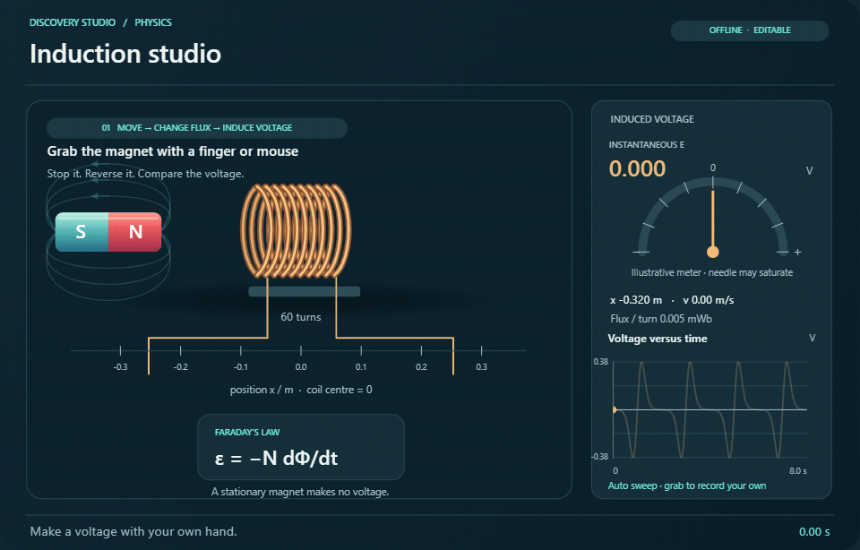
</p>

<p align="center"><sub>Actual offline lab rendering, with playback sped up for the demo. <a href="docs/showcase-qa/three-showcases.png">Prefer a still image?</a></sub></p>

| Studio | Try this |
| --- | --- |
| **Induction** | Drag the magnet through the coil. Stop, reverse direction and replay your recorded movement against the voltage graph. |
| **Colour chemistry** | Follow the flask pours, indicator colour and CO₂ bubbles. Change the reactant amounts and compare the final mixture. |
| **Inside the heartbeat** | Pause at filling, atrial squeeze, ejection and relaxation. Follow the valve leaflets and either circulation route. |

**Pause the moment. Draw the explanation.** Each lab supports play/pause, stepping, scrubbing,
editable parameters and **Freeze & annotate**. Native files retain your deliberately frozen frame;
PNG export captures the displayed scene. Parameter edits and recorded hand movements participate in undo.

<details>
<summary><strong>Explore the rest of the library</strong></summary>

- **Physics:** projectile motion with a baseball and draggable launch vector; lenses and mirrors;
  magnet and coil; circuits and bulbs; pendulum and spring; waves and superposition; forces and friction.
- **Chemistry:** states of matter; atom-balanced reactions; a colour-change reaction apparatus.
- **Biology:** a two-loop circulation overview.

Use **Flask → Showcases** for the three deeper examples, **Browse all** for the complete set,
or **On this board** to return to an experiment you have already inserted.

</details>

These are **2D teaching models with visible assumptions**. Projectile motion and induction use
deterministic equations; fluid motion, indicator colours and heart timing include illustrative
approximations. Teacher and subject-expert review remains important. Continuous scientific motion
is not yet captured in lesson recordings; frozen edits, annotations and committed magnet traces are.
See [the scientific scope and QA evidence](docs/SCIENCE-SHOWCASE-QA.md).

### A closer look at the collection

These are **actual native lab captures** from disposable QA boards. The chemistry artwork in the
cover is a generated illustration; the scenes below show the app's current 2D teaching models.
Select an image to inspect the full-size view.

<table>
  <tr>
    <td width="50%"><a href="docs/assets/readme/gallery/chemistry.png">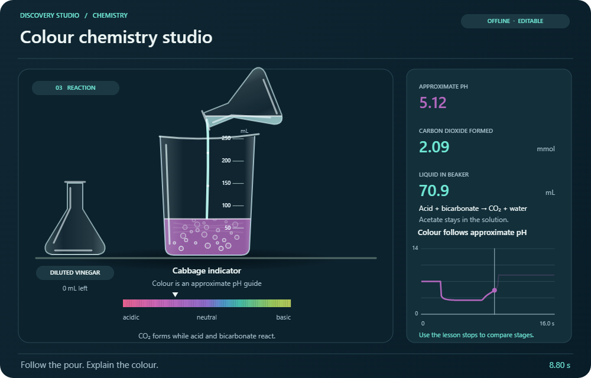</a><br /><strong>Colour chemistry</strong><br />Follow the pour, mixture and reaction progress.</td>
    <td width="50%"><a href="docs/assets/readme/gallery/heartbeat.png">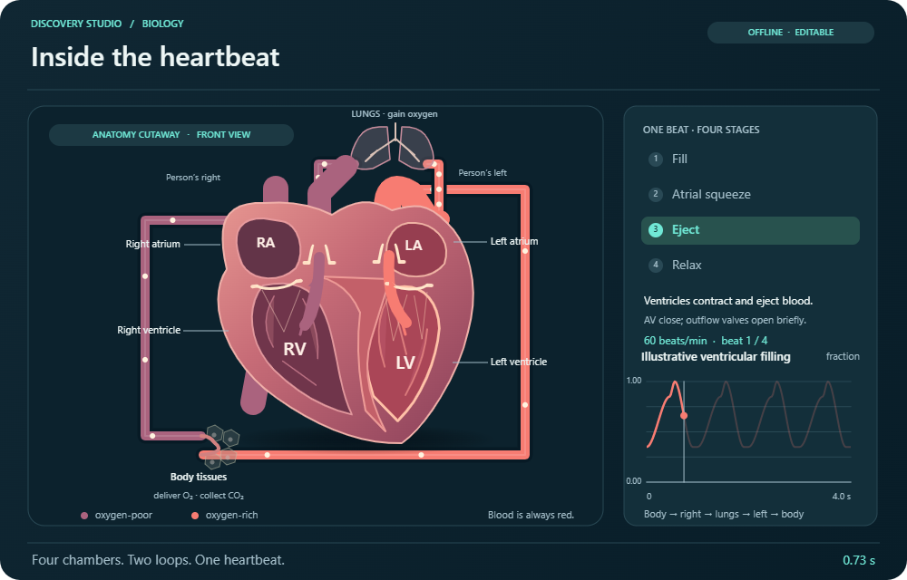</a><br /><strong>Inside the heartbeat</strong><br />Pause a cycle and explain the valves and flow.</td>
  </tr>
  <tr>
    <td width="50%"><a href="docs/assets/readme/gallery/induction.png">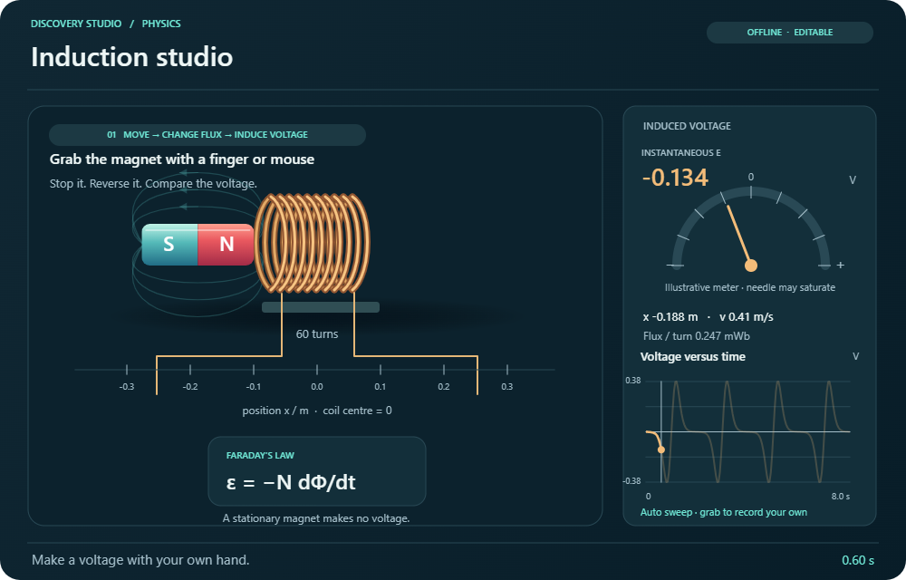</a><br /><strong>Induction in your hands</strong><br />Move the magnet and compare motion with voltage.</td>
    <td width="50%"><a href="docs/assets/readme/gallery/optics.png">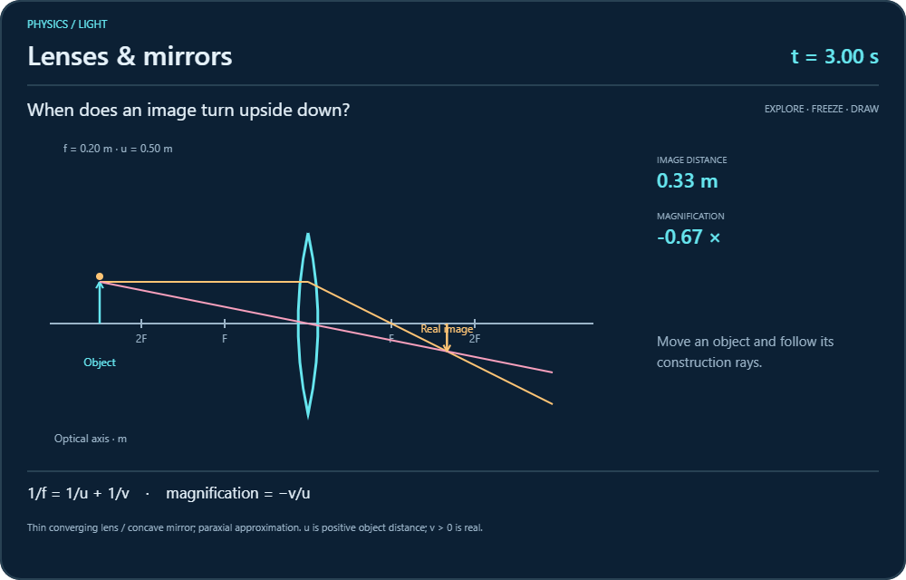</a><br /><strong>Light and images</strong><br />Explore the geometry of lenses and mirrors.</td>
  </tr>
  <tr>
    <td width="50%"><a href="docs/assets/readme/gallery/waves.png">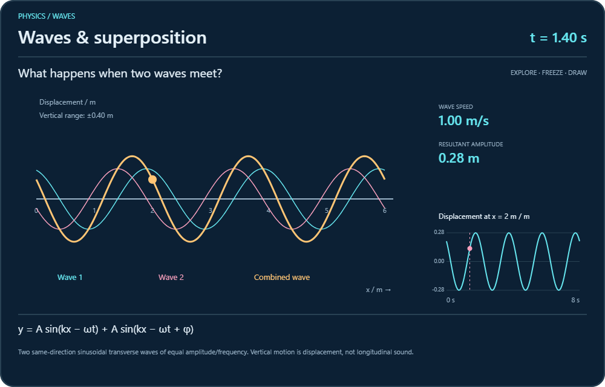</a><br /><strong>Waves together</strong><br />Make superposition visible, then freeze it.</td>
    <td width="50%"><a href="docs/assets/readme/gallery/circuits.png">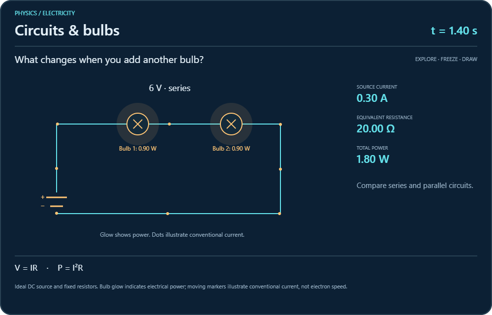</a><br /><strong>Circuits that explain</strong><br />Connect the diagram to its measured quantities.</td>
  </tr>
</table>

### A much bigger library, built with care

The long-term direction is **50+ interactive lessons**, starting with a strong physics collection
and expanding into chemistry and biology. That is a planning target, not a count of available labs
or a release promise. First comes deeper interaction and scientific review of the existing scenes;
then coherent topic packs, useful presets and a compact, searchable library.

See the [collection expansion plan](docs/SCIENCE-COLLECTION-PLAN.md) for topic ideas, priorities and
the quality checks each new lesson should pass. Contributions can improve a model, a diagram or a
teaching sequence as well as add a new experiment.

<details>
<summary><strong>Project artwork and repo card</strong></summary>

The [transparent logo](docs/assets/brand/floating-whiteboard-logo.png),
[GitHub social card](docs/assets/social/repo-card.png) and
[editable card template](docs/assets/social/repo-card.template.html) live in the repository.
See [editing and export instructions](docs/assets/social/README.md) and
[artwork sources and generation prompts](docs/assets/readme/GENERATION.md).

</details>

## Get started

### Use the app

**[Download Windows installer](https://github.com/EruditeCoder108/Whiteboard/releases/download/v1.5.0-beta.1/Floating-Whiteboard-Setup-1.5.0-beta.1-x64.exe)** ·
[Portable EXE](https://github.com/EruditeCoder108/Whiteboard/releases/download/v1.5.0-beta.1/Floating-Whiteboard-Portable-1.5.0-beta.1-x64.exe) ·
[Release notes and checksums](https://github.com/EruditeCoder108/Whiteboard/releases/tag/v1.5.0-beta.1)

Windows x64 science preview **1.5.0-beta.1**. These binaries are unsigned.

The current Windows target is **Windows 10 or 11, x64**. Normal board and science use needs no separate
Node.js, Python, Blender or API key. The runtime is bundled.

- **Installer:** run the setup `.exe` and choose where to install.
- **Portable:** run the portable `.exe` without an installation step. Its data still lives in your local AppData folder.
- **Move your work:** save a native board file, copy it to the other PC, then open it there.

The downloadable preview corresponds to tag **v1.5.0-beta.1**. Later source commits may be newer
than that build. Visit [Releases](https://github.com/EruditeCoder108/Whiteboard/releases) for available
versions, or build from source below. Builds are unsigned unless signing credentials are supplied;
Windows trust policies can warn or block them. [Installation and transfer details](docs/INSTALL-ON-ANOTHER-PC.md).

### Run from source

Use **Node.js 22.12 or newer** and npm on Windows.

```bash
git clone https://github.com/EruditeCoder108/Whiteboard.git
cd Whiteboard
npm ci
node node_modules/electron/install.js
npm run dev
```

The explicit Electron install step handles npm setups that skip dependency install scripts.
Building dependencies initially needs network access; normal app use does not.

## A few shortcuts worth remembering

| Action | Shortcut |
| --- | --- |
| Select / lasso | `V` / `Q` |
| Text / sticky note | `T` / `N` |
| Eraser / switch eraser mode | `E` / press `E` again |
| Laser pointer | `K` |
| Undo / redo | `Ctrl+Z` / `Ctrl+Shift+Z` or `Ctrl+Y` |
| Duplicate / group | `Ctrl+D` / `Ctrl+G` |
| Hide the interface | `Tab` |
| Toggle pointer pass-through | `Ctrl+Shift+Space` globally |
| Hide/show the window | `Ctrl+Shift+H` globally |
| More help | `F1` |

Press and hold on the canvas for the radial menu. See the [user guide](docs/USER-GUIDE.md)
for pen buttons, touch settings, object editing, local recovery and native file formats.

## Record an explanation once. Reuse it later.

Open the **clapperboard → Start recording**, then draw and edit normally. Ink retains its sample
timing and pressure; committed edits and camera changes become timed steps. Replay previews a
separate canvas, preserving the working board and its undo history.

Save a portable `.wbrp` lesson, keep an editable frame, or export a silent **1280 × 720 WebM**.
Microphone audio, desktop apps and transient laser trails are outside the recording.
[Recording and playback details](docs/USER-GUIDE.md#record-and-replay-a-lesson).

## Optional agent tools

The sparkle menu offers offline diagram starters and arrangement tools. External agents can use a
validated local MCP interface; access starts disabled, binds to loopback and uses a per-session token.
The external adapter needs Node.js 22+.

An optional assistant can connect to a local or compatible inference server. A model/server is not
bundled, and remote providers can have their own keys and costs. Drafts require review before being
applied as ordinary undoable objects. [Setup, privacy boundaries and examples](docs/AGENT-INTEGRATION.md).

## Build and test

```bash
npm run typecheck
npm test
npm run build
npm start
```

| Command | What it does |
| --- | --- |
| `npm run e2e` | Build and exercise ordinary drawing and editing in a disposable profile. |
| `npm run e2e:showcases` | Check the three studios, hand-motion recording, freeze, persistence and PNG export. |
| `npm run e2e:library` | Exercise all fourteen experiments and responsive library navigation. |
| `npm run e2e:replay` | Check lesson recording, replay and video export. |
| `npm run dist` | Build a Windows installer and portable executable in `dist/`. |
| `npm run dist:showcase` | Build preview packages separately in `dist/showcase-preview/`. |
| `npm run dist:signed` | Require configured signing credentials for the release build. |

The **12 October 2026 QA snapshot** records 495 source checks and 30 packaged-runtime checks.
These are dated results, not a live CI badge or a guarantee about every pen, display or PC.
[Read the evidence and limitations](docs/SCIENCE-SHOWCASE-QA.md).

## Under the hood

```text
src/main/             Electron windows, local storage, hotkeys and agent service
src/preload/          Narrow, typed bridge between renderer and main process
src/shared/           Shared IPC and command contracts
src/renderer/src/
  engine/             Ink geometry, hit testing, transforms, undo and rendering
    science/          Versioned models, transient clocks and native lab scenes
  state/              Signals, actions and shortcuts
  ui/                 Preact controls, editors and the animation library
tests/                Unit and reference checks
e2e/                  Disposable-profile Electron and device-input checks
```

Document items are immutable. Playback clocks stay transient until you deliberately freeze or
commit an edit. Board rendering, lab thumbnails, frozen replay frames and PNGs share the same
scene functions. [More design decisions](docs/USER-GUIDE.md#design-decisions-worth-knowing).

## What is next

The focus is thoughtful interaction and reliable teaching workflows: richer direct manipulation,
teacher review, physical pen/touch testing and visible performance on everyday hardware.
Connected diagrams, local pages/assets, PDF references and richer lesson presentation remain on
the [product roadmap](ROADMAP.md). The [science roadmap](docs/SCIENCE-ROADMAP.md) tracks that work separately.

## Contributing

Bug reports, reproducible input issues, accessible UI improvements and scientific corrections are
welcome. A useful report says what you expected, what happened and how to reproduce it using a
synthetic board. Keep personal boards, credentials and signing keys out of issues and commits.

Read [CONTRIBUTING.md](CONTRIBUTING.md) before changing code and [SECURITY.md](SECURITY.md)
before reporting a security issue.

## Licence and credits

Floating Whiteboard's own code is licensed under **GNU GPL version 3 only**.
Copyright © 2026 Floating Whiteboard contributors.
You may use, study, modify and redistribute it under [the licence terms](LICENSE).
Distributed derivatives must meet GPLv3's source and licence obligations.

The app builds on Preact and Signals, perfect-freehand, Lucide, Mediabunny and Electron.
Those projects retain their own licences; see [third-party notices](THIRD_PARTY_NOTICES.md).
The [media credits](docs/assets/readme/README.md) identify the official technology artwork.

<p align="center"><sub>Made for the moment an explanation finally clicks.</sub></p>
